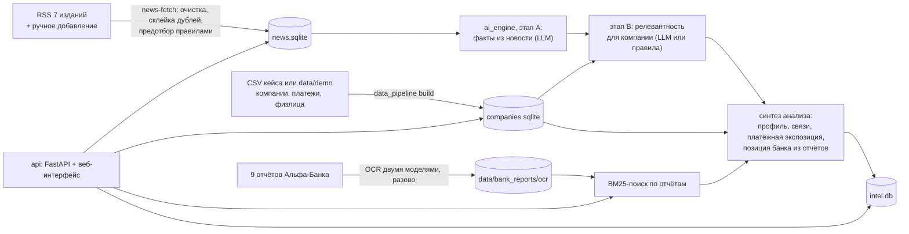

# SXSVN Intelligence

Сервис помогает отслеживать новости и оценивать их возможное влияние на выбранную компанию. Он состоит из трёх модулей:

- `data_pipeline` готовит базу компаний, каталог новостей, связи и платёжные показатели.
- `ai_engine` извлекает факты, классифицирует новости и формирует анализ с основаниями и ограничениями.
- `api` связывает модули и предоставляет веб-интерфейс и REST API.

## Архитектура

Модульный монолит на Python: три пакета в одном репозитории и одном процессе API, плюс необязательный фоновый worker с очередью Redis.



| Модуль | Что делает | LLM |
|---|---|---|
| `data_pipeline` | CSV → SQLite: профили компаний с источником каждого поля, связи (платежи, группа, общие физлица), доли платежей по отраслям; сбор новостей из RSS, очистка, склейка дублей, предотбор (связано / нужна проверка / не связано); OCR и поиск по отчётам банка | только разовый OCR отчётов |
| `ai_engine` | этап A — факты из текста новости с дословными цитатами; этап B — релевантность для конкретной компании; синтез — механизм влияния, риски, основания, ограничения, «что проверить»; уточнения пользователя | да (OpenAI-совместимый API) |
| `api` | REST API (`/docs`), фоновые задания анализа, веб-интерфейс | нет |

Принципы:

- **Ничего не выдумываем.** Каждое поле профиля ссылается на файл, колонку или правило. Факт из новости подкреплён дословной цитатой. Пропуски в данных перечислены явно.
- **Позиция Альфа-Банка отделена от выводов модели.** В результате анализа есть отдельный блок с цитатами из отчётов банка, датой и страницей. Если материалов нет, так и написано.
- **Платёж — наблюдение, а не доказательство зависимости.** Связи с контрагентами помечаются как неподтверждённые.
- **Дешевле там, где можно.** Предотбор правилами отсеивает около трети новостей до платной модели. Поиск по отчётам работает без LLM.

Подробнее: [интеграция модулей](docs/INTEGRATION.md), [контракты](docs/CONTRACTS.md), [подготовка данных](docs/DATA_PIPELINE.md).

## Быстрый запуск в Windows

Нужен Python 3.11 или новее. Для локальной установки из корня репозитория выполните в PowerShell:

```powershell
python -m venv .venv
.\.venv\Scripts\Activate.ps1
python -m pip install --upgrade pip
python -m pip install -e ".[dev]"
Copy-Item .env.example .env
```

Чтобы установить ровно те версии зависимостей, на которых проект проверен, используйте `requirements.lock`: `python -m pip install -r requirements.lock`, затем `python -m pip install --no-deps -e .`. Лицензии сторонних компонентов перечислены в [THIRD_PARTY_NOTICES.md](THIRD_PARTY_NOTICES.md).

Исходные CSV не входят в репозиторий. Скопируйте их в `data/raw/`:

- `df_Uid_data_hack.csv`
- `df_Uid_payment_hack.csv`
- `df_Fid_Uid_link_hack.csv`

Если CSV кейса нет, используйте синтетический демо-набор из `data/demo/`: те же три файла и колонки, 86 выдуманных компаний (12 крупных — топливо, металлургия, удобрения, ритейл, стройка и др.), платежи и связанные физлица. Скопируйте его в `data/raw/` (`Copy-Item data\demo\*.csv data
aw\`) или соберите базу напрямую: `python -m data_pipeline --raw-dir data/demo build`. Это не данные кейса, цифры выдуманы; перегенерировать: `python -m data_pipeline demo-data`.

Соберите базу компаний и загрузите новости из RSS:

```powershell
python -m data_pipeline build
python -m data_pipeline news-fetch --max-items 30
```

Команда RSS требует доступа к источникам в интернете. Без исходных CSV база компаний не соберётся. Каталог новостей создаётся при первой загрузке или при первом обращении API.

Укажите в `.env` ключ `LLM_API_KEY`: без него не работает анализ новостей («Разобрать для компании»), потому что факты из текста новости извлекает только модель. Без ключа работают профили компаний, связи и платёжные показатели, сбор и предотбор новостей и поиск по отчётам банка. Режим `CLASSIFIER_MODE=rules` заменяет правилами только классификацию релевантности, но не извлечение фактов. Не публикуйте и не коммитьте `.env`.

Запустите приложение:

```powershell
python -m uvicorn api.main:app --reload
```

- Веб-интерфейс: <http://127.0.0.1:8000/>
- Проверка сервисов и данных: <http://127.0.0.1:8000/api/v1/health>
- Swagger с интерактивными запросами: <http://127.0.0.1:8000/docs>

Остановить сервер можно сочетанием `Ctrl+C`.

## Работа в приложении

### Обзор

Выберите компанию. На экране появятся последние новости категорий «Связано» и «Нужна проверка». Нажмите новость, чтобы прочитать её и открыть анализ для этой компании. Кнопка «Обновить ленты» загружает новости из доступных RSS-источников, затем обновляет список и показывает статистику загрузки.

### События

Здесь доступны полный каталог публикаций, поиск по заголовкам и тексту и фильтр релевантности: все категории, связанные новости, требующие проверки или не связанные с компанией. Сначала выберите компанию во вкладке «Обзор» или «Компания», затем откройте событие и нажмите «Разобрать для компании». Выбор компании сохраняется при переходе между разделами.

Кнопка «Добавить новость» сохраняет публикацию вручную. Укажите заголовок и текст; ссылку и дату можно добавить по желанию. Дубликаты сохраняются как повторные источники.

### Результат анализа

Анализ выполняется в фоне. Интерфейс показывает этап и прогресс, а затем — резюме, релевантность, направление и горизонт воздействия, основания, источники, ограничения и рекомендуемые проверки. Если вывод требует уточнения, добавьте его в карточке анализа. Такое уточнение сохраняется как заявление пользователя, а не как независимо подтверждённый факт.

Результат анализа сохраняется в базе и привязан к компании и новости. Браузер также хранит кэш последних результатов и показывает его при повторном выборе новости.

### Компания и аналитика банка

- Вкладка «Компания» показывает профиль, финансовые показатели, связи и платёжную экспозицию выбранной компании. Платёжная связь сама по себе не доказывает зависимость между компаниями.
- Вкладка «Аналитика банка» ищет фрагменты в распознанных банковских отчётах. OCR-фрагменты включены в `data/bank_reports/ocr/`; для поиска по ним LLM-ключ не нужен.

## Сценарий проверки (10–15 минут)

Подойдут и данные кейса, и синтетический демо-набор. Платные шаги — только анализы, около 1–2 ₽ за каждый.

1. **Установка и данные.** Выполните «Быстрый запуск». Без CSV кейса соберите базу из демо-набора: `python -m data_pipeline --raw-dir data/demo build`. Затем загрузите новости: `python -m data_pipeline news-fetch --max-items 30`.
2. **Запуск.** Выполните `python -m uvicorn api.main:app`. В ответе <http://127.0.0.1:8000/api/v1/health> все сервисы должны быть `true`.
3. **Компания.** На вкладке «Компания» выберите крупную компанию: в демо-наборе это топливная `U_DEMO_001` и стройка `U_DEMO_006`. Проверьте:
   - профиль: у каждого поля указан источник, пропуски перечислены;
   - связи: платёжные контрагенты, группа компаний, общие физлица;
   - доли платежей по отраслям.
4. **Аналитика банка.** Поищите «ключевая ставка». Вы увидите фрагменты отчётов Альфа-Банка с датой, страницей и точностью распознавания.
5. **Новость и предотбор.** Во вкладке «События» видны метки «Связано», «Нужна проверка» и «Не связано» с причинами. Через «Добавить новость» можно добавить свою, например «Банк России повысил ключевую ставку до 18%».
6. **Анализ под клиента.** Разберите одну и ту же новость о ставке для двух разных компаний: с кредитами и лизингом и без них. В демо-наборе это стройка `U_DEMO_006` с кредитом и IT `U_DEMO_012` без кредитов. Сравните:
   - релевантность, направление и горизонт;
   - механизм влияния;
   - блок «Позиция Альфа-Банка» (отдельно от выводов модели);
   - «Основания вывода» с цитатами;
   - «Ограничения» и «Что проверить».
7. **Уточнение.** Добавьте уточнение, например «весь долг по фиксированной ставке до 2028 года». Анализ пересчитается, уточнение будет помечено как заявление пользователя.
8. **Автотесты.** Выполните `python -m unittest discover -s tests -t .`. Тесты работают без сети и LLM.

## Конфигурация

Настройки читаются из переменных окружения и файла `.env`. Основные переменные:

| Переменная | Назначение |
|---|---|
| `LLM_API_KEY` | Ключ OpenAI-compatible провайдера; обязателен для анализа новостей |
| `LLM_BASE_URL`, `LLM_MODEL` | Адрес и модель провайдера |
| `CLASSIFIER_MODE` | `auto` — LLM при наличии ключа, иначе правила; также `llm` или `rules` |
| `DATA_RAW_DIR` | Исходные CSV, по умолчанию `data/raw` |
| `DATA_DB_PATH` | База компаний, по умолчанию `data/processed/companies.sqlite` |
| `NEWS_DB_PATH` | Каталог новостей, по умолчанию `data/processed/news.sqlite` |
| `INTEL_SQLITE_PATH` | Результаты анализа и задания, по умолчанию `./intel.db` |
| `REDIS_URL` | Redis для отдельного обработчика очереди, по умолчанию `redis://localhost:6379/0` |

Таймаут LLM по умолчанию — 180 секунд, максимум ответа — 8000 токенов. Дополнительный поиск в банковской аналитике ограничен двумя запросами на один анализ. Полный список параметров приведён в [.env.example](.env.example).

## CLI и очередь

Посмотреть доступные команды:

```powershell
python -m data_pipeline --help
python -m ai_engine --help
```

Полезные команды:

```powershell
python -m data_pipeline report
python -m data_pipeline companies
python -m data_pipeline profile U_123
python -m ai_engine check-config
```

Обычный анализ из веб-интерфейса запускается фоновым заданием API и не требует отдельного Redis-worker. Redis и worker нужны для обработки новостей, явно поставленных в очередь. Если Docker доступен, запустите Redis в отдельном окне PowerShell:

```powershell
docker run --rm -p 6379:6379 redis:7-alpine
```

Убедитесь, что в `.env` задан правильный `REDIS_URL` (по умолчанию `redis://localhost:6379/0`). Затем в других терминалах запустите worker и поставьте новости в очередь:

```powershell
python -m ai_engine worker
python -m data_pipeline news-enqueue
```

Worker читает существующую очередь Redis; новая очередь для анализа из UI не создаётся.

## Docker Compose

Для сборки и запуска через Docker Desktop на Windows или Docker Engine на Linux используйте [инструкцию по Docker-развёртыванию](docs/DEPLOYMENT.md). В ней описаны подготовка данных, запуск API/Redis/worker, хранение SQLite и доступ через HTTPS reverse proxy.

Короткая последовательность после подготовки `.env` и CSV:

```powershell
docker compose --profile init run --rm init-data
docker compose up -d --build
docker compose ps
```

## Проверки и диагностика

Запустить полный набор тестов:

```powershell
python -m unittest discover -s tests -t .
```

Проверить логи API и worker:

```powershell
docker compose logs --tail=100 api worker
```

Если компании не отображаются, проверьте, что CSV находятся в `data/raw/` и база создана командой `python -m data_pipeline build` (или `init-data` в Docker). Если список новостей пуст, загрузите RSS командой `python -m data_pipeline news-fetch --max-items 30` или кнопкой «Обновить ленты». Состояние файлов данных видно в ответе `/api/v1/health`.

Дополнительные сведения:

- [API и веб-интерфейс](api/README.md) — маршруты и примеры запросов.
- [Подготовка данных](docs/DATA_PIPELINE.md) — состав CSV и расчёты профилей.
- [Интеграция модулей](docs/INTEGRATION.md) — границы и контракты компонентов.
- [Docker-развёртывание](docs/DEPLOYMENT.md) — серверная настройка и обновление.
- [Сторонние компоненты и лицензии](THIRD_PARTY_NOTICES.md); точные версии зависимостей — `requirements.lock`.
